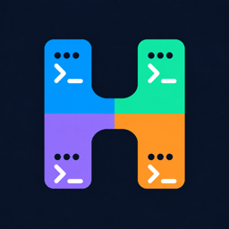
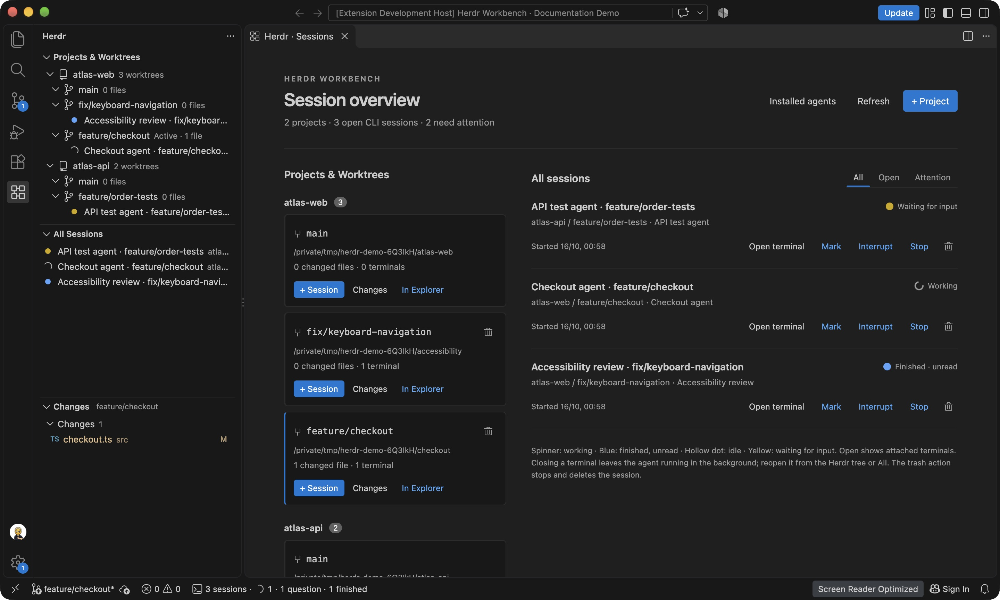
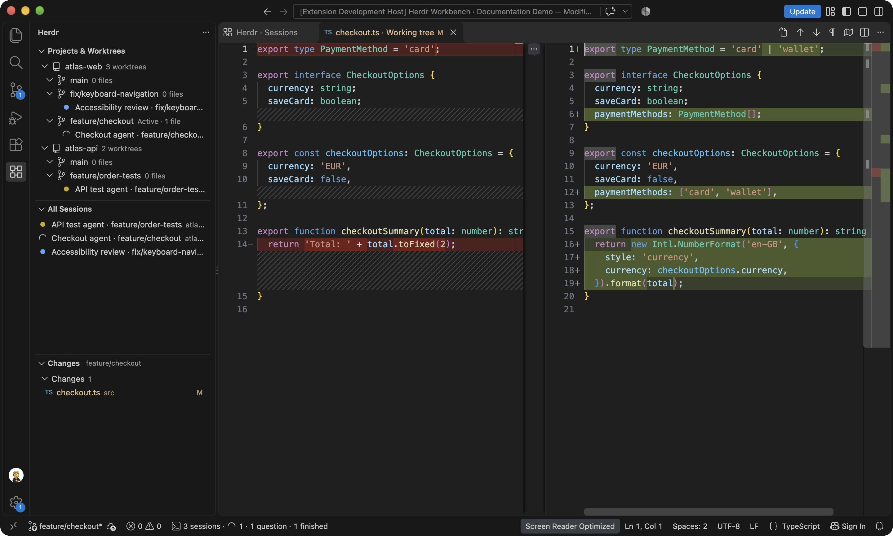
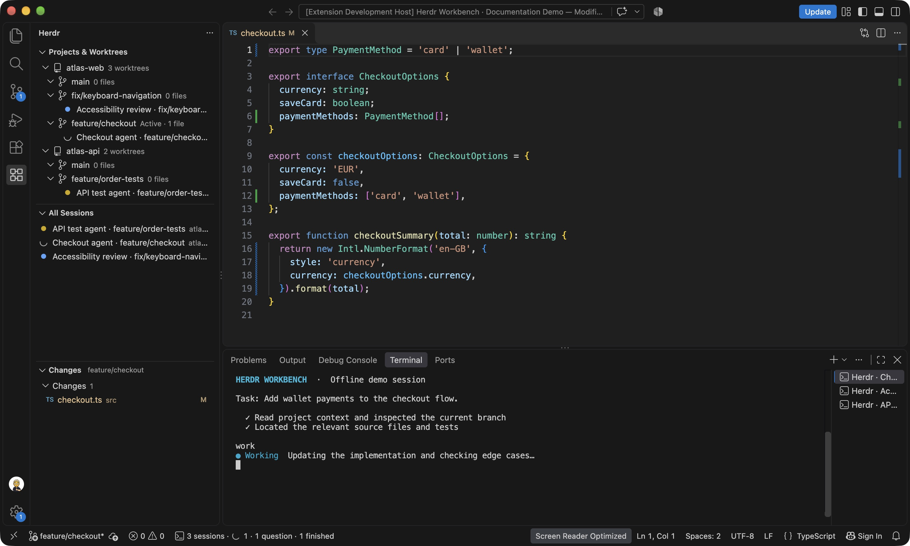
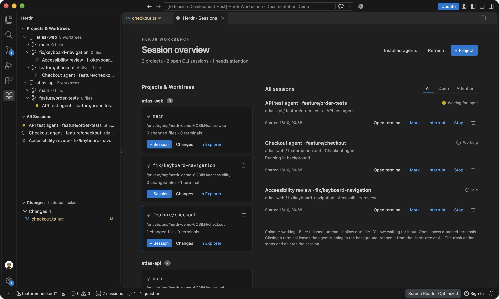

# Herdr Workbench

**Git worktrees and persistent CLI agents, together in VS Code.**

Herdr Workbench brings multiple Git projects, their worktrees, and CLI coding-agent sessions into one Visual Studio Code window. Select a worktree to make it your active editing context, start an installed agent in that checkout, and follow its progress alongside sessions running in other projects.

VS Code provides the Explorer, search, tasks, Source Control, diff editors, and integrated terminals. **The herdr backend owns the agent processes and reports their status**, so agents can keep working after you close their terminal view or the VS Code window. Clicking a session reconnects its terminal to the existing process.

This is an independent extension for herdr. It uses herdr's CLI and socket API; its terminal user interface is not opened or embedded.



*Track working agents, input requests and unread completions across projects. Screenshots show real VS Code windows with local demo repositories and an offline fixture agent.*

## What you can do

- Keep a catalog of several Git projects and discover their existing worktrees automatically.
- Switch the active workspace to a selected checkout for editing, searching, Git operations, tasks, and new terminals.
- Create a worktree on a new branch using a local branch, a known remote branch, `HEAD`, a tag, or a commit as its starting point.
- Run several CLI agents in the same worktree or in separate worktrees and projects.
- See which agents are working, waiting for input, or finished with an unread result.
- Close a terminal view, leave its agent running in the background, and reopen the same session later.
- Inspect changes in VS Code's native Git view and diff editor, with separate groups for staged changes, working changes, untracked files, and conflicts.
- Interrupt, stop, mark, or delete individual sessions, and remove clean linked worktrees through their trash icons.

For example, you can leave an agent working on a feature in one project, switch to another project's checkout, and work there. The first session stays in the Herdr tree. Selecting it later activates its worktree and opens a terminal connected to the same agent.

## Native Git and terminals



*Review the selected checkout with native Git views and diffs. Worktree and session navigation stays in the sidebar.*



*Open a session's terminal alongside its source files. Close the terminal to leave the agent in the background, then click the session in the Herdr tree to reconnect.*

## Requirements

- **Visual Studio Code 1.93 or later**, with the built-in Git extension enabled.
- **Git** on the extension host.
- **herdr 0.9.0 or later**, in a build that provides `terminal session control` and the workspace, terminal, and agent APIs used by this extension.
- At least one installed agent CLI supported by both this extension's discovery catalog and your herdr build. Set up that CLI's authentication and configuration as you normally would.
- A trusted workspace with access to real filesystem directories. Virtual workspaces are not supported.

Install Git, herdr, and the agent CLIs on the machine running the VS Code workspace extension host. If herdr is outside the executable search path, set `herdr.executablePath` and reload the window.

The installed extension runs directly in VS Code without a separate build or runtime npm dependencies. The offline packager requires Node.js and Python 3; Marketplace packaging uses the official `@vscode/vsce` development dependency.

## Installation

Install [Herdr Workbench from the Visual Studio Marketplace](https://marketplace.visualstudio.com/items?itemName=tynamix.vscode-herdr), or search for **Herdr Workbench** in VS Code's Extensions view. Git, herdr and your chosen agent CLIs must also be installed on the extension host.

To create an installable extension package from source, run this command in the repository:

```sh
npm run package
```

The current package is written to `dist/herdr-workbench-0.1.0.vsix`. In VS Code, run **Extensions: Install from VSIX…** and select that file. Packaging uses local tools and does not download npm packages.

To try the source in a separate development window instead, see [Development](#development).

Maintainers: see [Publishing to the Marketplace](docs/PUBLISHING.md) for publisher setup and the validated release package, and [Screenshot workflow](docs/SCREENSHOTS.md) to reproduce the documentation scenes.

Marketplace updates are automated after successful checks on `main`, using Conventional Commit titles for versioning. See [automated publishing setup](docs/PUBLISHING.md#one-time-github-setup) for GitHub configuration and publishing credentials.

## First session

1. Open the **Herdr** icon in the Activity Bar.
2. Choose **Add project** and select a Git checkout. You can add either the main checkout or a linked worktree; checkouts belonging to the same repository are grouped as one project.
3. Expand the project to see its worktrees, branch names, and changed-file counts.
4. Select the worktree you want to use. By default, it becomes the window's active workspace folder.
5. Click the worktree's **play** icon and select an available agent profile. The agent starts in that worktree's directory and its terminal opens in VS Code.
6. Open **Herdr: Open session overview**, or click the Herdr session count in the status bar, to see the dashboard.

You can repeat these steps to add more projects and start more sessions. Multiple sessions in the same worktree share the same files. Use separate worktrees when the sessions need separate working directories.

Panel sessions automatically use an agent-focused layout when started or opened: **Herdr on the left, a maximized terminal in the main area, and the terminal list on the right**, even with only one terminal. Opening a session restores this arrangement rather than toggling it. Existing editor tabs and unrelated terminals are kept. Set `herdr.autoArrangeSessions` to `false` to keep your manual layout; `herdr.terminalLocation: "editor"` also keeps the normal editor layout. Sidebar and terminal-tab preferences are set at workspace level, not globally; disabling automatic arrangement stops future layout changes but does not undo the current arrangement or those preferences.

## Projects, worktrees, sessions, and terminals

| Item | Meaning |
| --- | --- |
| Project | A Git repository registered in Herdr's catalog, including its main checkout and linked worktrees. |
| Worktree | A checkout directory with its own working files and Git state. This is the directory in which a session runs. |
| Session | A tracked CLI-agent session owned by the herdr backend, associated with a project and worktree. |
| Terminal | The VS Code view connected to a session. Closing the view leaves the backend session running. |

The sidebar has three views:

| View | Purpose |
| --- | --- |
| **Projects & Worktrees** | Projects, their discovered worktrees, and sessions grouped beneath each worktree. |
| **All sessions** | Sessions across all registered projects, including background sessions and ended history. |
| **Changes** | Changes in the selected worktree. Clicking a file opens a native diff, or the file itself for a conflict. |

Projects and sessions are stored per VS Code workspace. Adding a project to this catalog does not immediately add all of its worktrees to the Explorer.

## Switching your active worktree

With the default `herdr.switchWorkspaceOnSelect: true`, selecting a worktree makes it the **only workspace folder** in the window. Explorer, workspace search, workspace tasks, and the selected Git repository then follow that checkout. The other projects and worktrees stay in Herdr's catalog.

Starting or opening a session also selects its worktree. The folder icon and **In Explorer** action select the worktree and open its Explorer. The Source Control action selects it and opens VS Code's built-in Git view, where you can stage, commit, and inspect changes normally.

For a workspace managed this way, Herdr sets workspace-level `terminal.integrated.cwd` and `terminal.integrated.splitCwd` values so new terminals and splits start in the selected worktree. Existing terminals keep their current directories and existing agents keep running. Disabling automatic workspace switching restores the terminal settings that Herdr saved before changing them.

The Git view is kept focused on the selected repository. Herdr preserves separate commit-message drafts when you switch between checkouts. Changes on disk remain in their respective worktrees; switching does not copy, stash, commit, or merge them.

### Workspace files and extension restarts

Replacing the first workspace folder can cause VS Code to restart its extensions. Herdr saves its catalog, selection, commit drafts, and any pending session-opening action before making that switch. The action can then complete after activation.

When switching away from a normal single-folder window, Herdr converts it into an initially untitled workspace and transfers its catalog. Save it with **File → Save Workspace As…** so you can reopen the same workspace later. If you start from an empty window, Herdr creates a workspace file in its VS Code storage directory. Existing named workspaces retain their workspace file while their folder selection changes.

### Keeping a manually managed multi-root workspace

Set this option if you want to control workspace folders yourself:

```json
{
  "herdr.switchWorkspaceOnSelect": false
}
```

Herdr will still select the worktree's Git context, but leave the workspace folder list in your control. **In Explorer** adds the selected worktree as another workspace folder. Agent sessions still start in their assigned worktree directory.

## Creating and deleting worktrees

### Create a worktree

Click the **branch** icon on a project, or run **Herdr: Create worktree with a new branch**.

1. Select a starting point from the local branches, already known remote branches, or `HEAD`. Choose **Enter branch or commit …** to enter a branch, tag, or commit manually.
2. Enter a name for the new branch.
3. Choose the new worktree's destination directory.

Herdr asks Git to create the worktree and new branch from the selected commit, then refreshes the project tree. Remote branches are read from the repository's existing refs; this action does not fetch them automatically.

### Delete a worktree

Click the **trash** icon on a linked worktree in the sidebar or dashboard. After confirmation, Herdr removes the checkout directory and its worktree registration through `git worktree remove`. **The branch is retained.** If you delete the selected worktree, Herdr activates an available remaining checkout and removes the deleted folder from the workspace.

The main checkout has no worktree trash action. Deletion is also blocked while the target has running sessions, including background sessions, unsaved editor documents, Git changes, or a worktree lock. Stop the sessions and save, commit, or otherwise preserve the changes first. Git's normal removal checks apply; the extension does not force removal.

To remove a project from Herdr's catalog, use **Herdr: Remove project from overview** in the project's context menu. This removes the catalog entry rather than deleting its files. Connected sessions must be stopped first.

## Managing sessions

### Terminal views and background sessions

Closing a session's terminal immediately removes it from the dashboard's **Open** filter and from the open-session count. Its agent continues running in herdr. The session remains in the sidebar and under **All**, with a **Background** label while the backend is connected.

Click the session in either sidebar tree, or use **Open terminal**, to open a terminal view connected to the same process. Reopening a session does not run its launch command again. With automatic workspace switching enabled, its worktree also becomes active.



*The session remains available under All and in the Herdr tree. The open-terminal count drops as soon as its terminal closes.*

### Session actions

| Action | Effect |
| --- | --- |
| **Open terminal** / click the session | Show the existing terminal or attach a new terminal view to the existing session. |
| **Interrupt** | Send Ctrl+C to that session, for example to interrupt the agent's current turn. The CLI determines how it handles the signal. |
| **Stop** | Close the corresponding herdr session and its process. Keep the ended entry in history. |
| **Trash / Delete session** | Confirm deletion for an active session, stop its agent, close its terminal, and remove its history entry. Ended history is removed directly. |
| **Remove session from history** | Remove an ended entry through the context menu, without stopping an active session. |
| **Mark** | Set or clear a manual **Needs input** or **Ready for review** flag. |

Stopping or deleting one session leaves the other sessions running. If the backend is unreachable, Herdr retains sessions that might still be running until their state can be checked again.

### Scrolling conversations

Scroll over the session terminal with a trackpad or mouse wheel. Herdr forwards the event to the agent's own conversation view when it supports mouse scrolling; ordinary terminal output uses the backend's scrollback instead of VS Code's local frame buffer. **Page Up / Page Down** scroll by a page (on Mac keyboards, **Fn + ↑ / ↓**). These shortcuts apply only to an active Herdr-backed terminal; unrelated terminals keep their usual keybindings. An agent can still interpret page keys itself, so its own bindings/settings determine navigation inside a full-screen conversation.

The renderer captures mouse reports for scrolling. Mouse clicks are not forwarded by the current backend control protocol; use keyboard navigation inside an agent and VS Code's selection modifier when selecting terminal text.

### Dashboard filters

- **All** includes sessions with open terminals, background sessions, and ended history.
- **Open** includes sessions with an attached VS Code terminal view. It is a view of open terminals, not a count of all running backend processes.
- **Attention** includes sessions waiting for input or displaying an unread completion, including matching manual flags.

The status bar's session count also counts attached terminals. Its working, question, and completion indicators can still reflect sessions running in the background.

## Agent status indicators

The sidebar and dashboard use the same status information:

| Indicator | Meaning |
| --- | --- |
| Spinning icon | The agent is working. |
| Yellow dot | The agent is waiting for input or approval. |
| Blue dot | An agent turn has finished and its completion has not yet been acknowledged. Opening the session acknowledges it. |
| Hollow dot | The agent is idle, the session has ended, or the connection/status is unavailable; read the accompanying label. |

An open session can be idle. Finishing an agent turn does not necessarily end its CLI session. An unread completion indicates that a turn ended; it is not a judgment about the quality of the result.

Manual input/review flags take precedence over the automatic indicator until you clear them. They also affect attention filtering and session ordering. When herdr cannot supply a state, the extension shows an unknown or disconnected label rather than assuming the agent is working or finished.

### Pi status integration

For Pi sessions, the extension adds `integrations/pi-status.mjs` to that process's launch command using `--extension`. It reports Pi lifecycle and prompt events to the owning herdr server, including settled turns and prompts for input or approval. The integration has been tested with Pi 1.2; it does not change global Pi configuration.

For other agents, status comes from herdr's integrations or detection. The accuracy of working and input-waiting states depends on the corresponding agent integration. Herdr Workbench does not globally install additional hooks for those CLIs.

## CLI discovery and custom profiles

Use **Herdr: Detect installed agents** to see the available profiles. Discovery is repeated when starting a session.

The extension searches `PATH` and common installation directories. Examples include `/opt/homebrew/bin`, `/usr/local/bin`, `~/.local/bin`, and `~/.cargo/bin` on Unix-like systems, and npm/Scoop locations on Windows. Discovery checks executable files without starting the agents.

The built-in catalog includes Pi, Claude Code, Codex, OpenCode, Gemini CLI, GitHub Copilot CLI, and Cursor Agent, among others. The complete executable-to-agent mapping is in [`src/cli-discovery.js`](src/cli-discovery.js). **A profile is offered only when its executable is installed and its agent kind is supported by the installed herdr build.**

Default profiles are discovered automatically. Add custom executable paths or arguments with `herdr.agentProfiles`:

```json
{
  "herdr.agentProfiles": [
    { "id": "pi", "name": "Pi", "command": "pi" },
    { "id": "codex", "name": "Codex", "command": "codex" },
    {
      "id": "custom-pi",
      "name": "Custom Pi installation",
      "kind": "pi",
      "command": "\"/path with spaces/pi\""
    }
  ]
}
```

Profile IDs must be unique and contain only letters, numbers, underscores, or hyphens. An ID matching a detected default replaces that default. A command must be a single line starting with an executable name or an absolute executable path; arguments can follow it. Quote paths containing spaces. Shell aliases and functions cannot be reliably discovered as installed CLIs.

The agent `kind` is normally inferred from the executable name. Set it explicitly for wrappers or renamed executables. Custom profiles still need an agent kind recognized by the extension and supported by herdr. Each command is run only when you explicitly start that session, in its worktree's directory and backend shell.

## Settings

| Setting | Default | Behavior |
| --- | --- | --- |
| `herdr.switchWorkspaceOnSelect` | `true` | Make the selected worktree the only workspace folder. Disable to manage a multi-root workspace yourself. |
| `herdr.executablePath` | `"herdr"` | Executable name or absolute path for the herdr backend. Reload the window after changing it. |
| `herdr.agentProfiles` | `[]` | Custom profiles added to the discovered defaults; matching IDs replace defaults. |
| `herdr.refreshInterval` | `8` | Worktree and changed-file refresh interval in seconds, from 3 to 300. |
| `herdr.terminalLocation` | `"panel"` | Open session terminals in the terminal panel, or use `"editor"` for editor tabs. |
| `herdr.autoArrangeSessions` | `true` | Restore the agent-focused panel layout when starting or opening a session. Does not rearrange editor terminals. |

Session status is updated separately through backend events and polling. `herdr.refreshInterval` controls the Git/worktree refresh interval. **Herdr: Refresh** updates both worktrees and sessions on demand.

## Persistence and process ownership

The first session starts a herdr server in the background when needed. Each VS Code workspace has a saved backend name such as `vscode-…`, separate from your regular herdr session. The extension connects through herdr's socket API and displays a session's terminal through a VS Code pseudoterminal bridge.

Project registrations, session identifiers, the selected worktree, and commit-message drafts are stored in VS Code's workspace state. Reopening the **same saved workspace** restores that catalog and checks the existing backend sessions. A terminal can then be attached to a process that is still alive. The server and its agents can survive closing the VS Code window.

Reconnection never replays a saved launch command. The extension does not implement automatic process recovery after a computer restart or backend shutdown. It reconnects to surviving processes; an ended session remains history, and you can start a new session when needed.

Terminals created by earlier versions that launched agents directly remain usable while connected. Their running processes cannot be transferred into the backend. New sessions use herdr's process management. Unrelated terminals and sessions outside this extension's recorded catalog are not adopted.

## Troubleshooting

- **herdr is not found or the terminal bridge is unavailable:** Check the installed herdr build and `herdr.executablePath`, then reload the window. The extension checks that the required CLI commands are available.
- **An installed agent is missing from the picker:** Run agent detection. Check the executable path, the profile's `kind`, and support in your herdr build. For a custom installation, use an absolute executable path in a profile.
- **A closed terminal's agent is still running:** Find it in the Herdr tree or the dashboard's **All** filter. Click it to reconnect, or use **Stop** or the trash action to end it.
- **A session is disconnected:** Check the backend before deleting it. A disconnected terminal view alone does not mean the backend process has ended.
- **A worktree cannot be deleted:** Stop its sessions, preserve any working changes and unsaved editor contents, and remove any Git worktree lock. The main checkout is protected.

Open the **Herdr Workbench** output channel in VS Code's Output panel for extension error details. Backend server logs are kept in the extension's VS Code storage directory under `backends/<backend-name>/server.log`.

## Development

JavaScript runs directly in the extension host; no compilation or runtime dependency installation is required. Run `npm ci` to install the release tooling before using `npm run package:marketplace`.

1. Open this repository in VS Code.
2. Press **F5** and select the **Herdr Workbench** launch configuration.
3. Use the separate development window to add projects and start sessions.

The launcher opens VS Code normally, then attaches the debugger to its running extension host on port `9333`. This avoids the direct extension-host debug startup that can crash on some VS Code/Electron installations. Breakpoints in `src/` still work.

The development window uses its own profile, extensions directory, and workspace under `.vscode-dev/`. Other installed extensions are disabled there; built-in Git and terminal features remain available. Your ordinary VS Code window keeps its own configuration. Trust the development workspace if prompted.

Pressing **F5** again reconnects to the existing development window. **Shift+F5** detaches the debugger and leaves that window and its terminals open. The debugger can reconnect after extension-host restarts; the launcher checks ownership before reusing an inspector. An unrelated process using port `9333` must be stopped or moved before this launcher can use the port. After source changes, run **Developer: Reload Window** in the development window.

You can also start the development window without attaching a debugger:

```sh
npm run dev
```

The development launcher supports `VSCODE_EXECUTABLE` for a custom VS Code executable. On macOS its default is the application executable; elsewhere it uses `code` from `PATH`. The GUI integration-test scripts default to the standard macOS VS Code CLI path; set `VSCODE_EXECUTABLE` to your VS Code CLI when using another installation.

### Checks and tests

```sh
npm run check
npm test
npm run test:backend
npm run test:integration
npm run test:worktree
# Optional: requires an installed Pi CLI, version 1.2 or later.
npm run test:pi
npm run package
```

| Command | Coverage |
| --- | --- |
| `npm run check` | JavaScript syntax and extension-manifest command registration. |
| `npm test` | Git/worktree handling, CLI discovery, sessions, dashboard filters, deletion behavior, workspace context, and development-launcher checks. |
| `npm run test:backend` | Real herdr socket events, agent status, and terminal reconnection. |
| `npm run test:integration` | An isolated VS Code window with temporary repositories: native Git/diffs, sessions, terminal reopening, deletion, and persistence after reopening the workspace. |
| `npm run test:worktree` | Workspace switching from both multi-root and single-folder windows, including Explorer/search/Git context, new and split terminals, tasks, session focus, and commit drafts. |
| `npm run test:pi` | A real Pi prompt using isolated Pi configuration. |

The backend and VS Code integration tests use an installed herdr build, a separate test backend, temporary repositories, and a local offline fixture agent. Those tests make no model API calls. The optional Pi test also uses isolated configuration to exercise a real CLI prompt.
